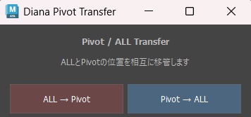

# Diana Pivot Transfer


**任意Pivot操作とALLコントローラーの変換移管を行う、Diana Character Rig専用のMaya Pythonツールです。**

キャラクターを任意の位置を中心に回転させる機能と、ALLコントローラーによる通常操作を組み合わせ、アニメーション制作時の操作性を向上させることを目的として制作しました。

## Overview | 概要



キャラクターアニメーションでは、転倒や大きな姿勢変更など、通常のルートコントローラーとは異なる位置を回転中心にしたい場面があります。

本ツールでは、任意Pivotによる回転操作とALLコントローラーの変換移管を行い、既存のリグ構造を活用した操作を可能にしています。

また、変換処理中にIKコントローラーの位置が変化し、アニメーターが設定したポーズが崩れる問題への対策として、World Matrixの保存・復元処理を実装しました。

## Demo | 動作デモ

### 01. Custom Pivot


任意Pivotを移動し、キャラクターの回転中心を変更します。

### 02. ALL → Pivot

ALLコントローラーをPivot側へ移管する操作です。

ALLのTranslate / Rotateが0の状態でも処理できるようにしています。

### 03. Pivot → ALL

逆方向の変換処理を実行します。

COGや左右Foot IKのWorld Matrixを保存・復元することで、変換時に脚のポーズが崩れる問題に対応しています。


## Features | 主な機能

- **Custom Pivot**：任意位置への回転中心の移動
- **Pivot / ALL Transfer**：2方向の変換移管
- **World Matrix Preservation**：変換前後のコントローラー姿勢を保護
- **IK Pose Preservation**：左右Foot IKおよびIKモードの腕コントローラーに対応
- **Matrix Validation**：変換結果の誤差を検証
- **Undo Support**：変換操作のUndo処理
- **Dedicated UI**：2ボタンのシンプルな操作画面

## Technical Details | 技術解説

### 01. Pivot Synchronization

`diana_pivot_v3.py`

任意Pivotの位置変更を監視し、`Body_Rot_SYSTEM_GRP` の回転Pivotへ反映する仕組みです。

Maya API 2.0の `MNodeMessage.addAttributeChangedCallback()` を使用してコントローラーの属性変更を検知します。

また、Pivot位置の変更時に不要なUndo履歴が増えることを抑えるため、Undo状態を一時的に制御しています。

### 02. Transform Transfer

`diana_pivot_to_all.py`

`cmds.xform()` を利用してWorld Matrixを取得し、PivotとALLの変換処理に使用します。

単純にTranslate / Rotateをコピーするのではなく、親階層やPivot設定の影響を考慮したWorld Matrixベースの処理を採用しています。

変換結果については、処理前後の行列要素を比較して誤差を検証します。

### 03. IK Pose Preservation

変換時にアニメーターが設定したポーズを維持するため、以下のコントローラーを保護対象としています。

| Controller | 対応 |
|---|---|
| `COG_anim` | 常時 |
| `L_i_K_Foot_anim` | 常時 |
| `R_i_K_Foot_anim` | 常時 |
| `Ik_L_hand_anim` | 左腕IK時 |
| `IK_L_elbow_anim` | 左腕IK時 |
| `Ik_R_hand_anim` | 右腕IK時 |
| `IK_R_elbow_anim` | 右腕IK時 |

腕についてはFK/IK設定を参照し、IKモードの場合にHand IKとElbow PVを保護対象へ追加します。

脚IKコントローラーのTranslateを一律に0へ戻す処理は行わず、設定済みのポーズを維持できるようにしています。

### 04. UI Design

`diana_pivot_transfer_ui.py`

Mayaの `cmds.window()` を使用して専用UIを構築しています。

処理の方向を視覚的に区別するため、2つのボタンを色分けしています。

また、実行時には処理モジュールを再読み込みし、処理結果やエラーをMaya上で確認できるようにしています。

## File Structure | ファイル構成

```text
Pivot_Transfer/
├── diana_pivot_to_all.py
├── diana_pivot_transfer_ui.py
├── diana_pivot_v3.py
└── README.md
```

| File | Description |
|---|---|
| `diana_pivot_to_all.py` | Pivot / ALLの変換処理 |
| `diana_pivot_transfer_ui.py` | 操作用UI |
| `diana_pivot_v3.py` | Pivot同期Callback |

## Usage | 使用方法

**動作環境：Autodesk Maya 2026 / Python 3**

本ツールはDiana Character Rig専用です。実行には対応するコントローラー階層とPivotシステムが必要です。

PythonファイルをMayaのPython検索パスに配置した後、Script Editorから以下を実行します。

```python
import importlib
import diana_pivot_transfer_ui as pivot_ui

importlib.reload(pivot_ui)
pivot_ui.show_ui()
```

Pivot同期処理が必要な場合は、対応するリグを開いた状態で次の処理を実行します。

```python
import diana_pivot_v3 as pivot
pivot.install()
```

CallbackはMayaのセッション中に動作するため、Maya再起動後には再登録が必要です。

## Design Philosophy | 設計方針

**リグは、アニメーターの操作上の問題を解決するためのデザインである。**

本ツールでは、機能を追加することだけでなく、既存のポーズを崩さずに操作を切り替えられることを重視しました。

アニメーターが変換処理のたびにIKコントローラーを再調整する必要がないよう、World Matrixによる姿勢保護を取り入れています。

今後も、操作の分かりやすさ、再現性、既存リグへの影響を意識したツール制作を目指します。

---

**Related Project:** [Diana Character Rig](https://github.com/Yuzuki-Midoshima/Diana-Character-Rig)